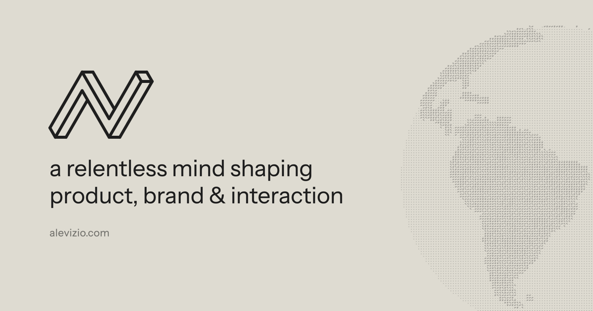

# alevizio.com

Personal portfolio site for Alejandro Vizio, built as a minimal single-page experience focused on product, brand, and interaction design.



## Live site

- Production: [alevizio.com](https://alevizio.com)
- Repository: [github.com/alevizio/alevizio.com](https://github.com/alevizio/alevizio.com)

## What is in this repo

- A custom animated landing page built with React, Vite, Tailwind CSS, and Motion
- A background of grey blocks, a slow noise field dithered on the GPU, with pointer-responsive ripples
- A copy-to-clipboard contact CTA and social profile links
- Company logo highlights, SEO metadata, Open Graph tags, `llms.txt`, sitemap, and robots configuration
- The actual source for the live portfolio, not just a static export

## Stack

- React 18
- Vite 6
- Tailwind CSS 4
- Motion
- Vercel Analytics
- Vercel Speed Insights

## Local development

```bash
npm install
npm run dev
```

Build a production bundle with:

```bash
npm run build
npm run preview
```

## Heavy images

`npm run lint:images` runs [oxlint-plugin-slimdeer](https://github.com/lndgalante/oxlint-plugin-slimdeer). It warns on the line of code that names a PNG or JPEG when that image could be at least 10% and 4 KiB smaller at about the same visual quality. It measures locally and uploads nothing. On every pull request, the Images workflow checks the code and images that pull request adds or changes, and adds its warnings as annotations; it never fails the check and never changes an image.

After `npm run lint:images`, to see the flagged images before and after, then shrink the ones you approve:

```bash
npx oxlint-plugin-slimdeer --review --flagged   # writes a comparison page, changes nothing
npx oxlint-plugin-slimdeer public/work/example.jpg   # shrinks that image in place (lossy, so commit first)
```

The first run measures every image and takes a few minutes; later runs use the cache in `node_modules/.cache/slimdeer`.

## Project notes

- The project started from a Figma Make export and was then refined directly in code.
- Production is served from `https://alevizio.com` on Vercel.
- The repository is prepared to be public for reference and transparency around the implementation.

## License and usage

This repository is source-available, but it is not open source.

- The site design, written copy, branding, and custom assets remain protected.
- Reuse, redistribution, or derivative work requires prior written permission unless a third-party license says otherwise.
- See [LICENSE](./LICENSE) and [ATTRIBUTIONS.md](./ATTRIBUTIONS.md) for details.
  
